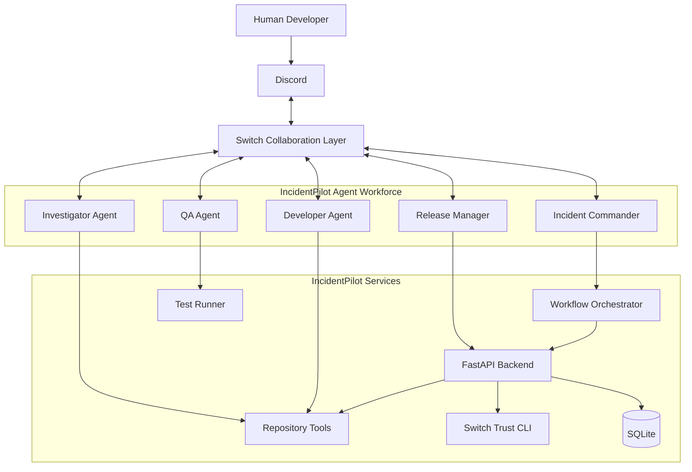

# INCIDENTPILOT
## Master Product Requirements, MVP Specification & Implementation Plan

**Project:** IncidentPilot  
**Tagline:** The Trust-Aware AI Engineering Workforce  
**Hackathon:** Flip the Switch 2026  
**Primary Track:** Best Business Workflow  
**Target Prize:** $2,000  
**Development Model:** Solo developer  
**Development Environment:** Windows 11, Codex, Antigravity  
**Target Completion:** November 7, 2026  
**Document Version:** 1.0 — Master Implementation Blueprint  
**Status:** Ready for implementation

---

# PART I — EXECUTIVE SUMMARY

## 1. Product vision

IncidentPilot is a collaborative AI engineering workforce that helps software teams investigate, diagnose, fix, test and resolve software incidents.

Unlike conventional AI chatbots, IncidentPilot connects specialized AI agents and human engineers through Switch shared rooms.

When a developer reports an incident, IncidentPilot coordinates an engineering workflow:

1. Receive and classify the incident.
2. Investigate logs, errors and repository code.
3. Identify possible root causes.
4. Delegate a proposed code fix.
5. Execute automated tests.
6. Evaluate agent security and reliability.
7. Request human approval for sensitive actions.
8. Execute an approved resolution workflow.
9. Publish an incident report and audit trail.

Switch is the central collaboration infrastructure. Agents and humans share the same conversation, tasks, decisions and incident context.

Switch Trust adds security scanning and adversarial evaluation.

## 2. Problem statement

Software engineering teams frequently experience:

- Repetitive incident investigation.
- Slow communication between developers and QA.
- Context switching between Slack, terminals and GitHub.
- Manual root-cause analysis.
- Incomplete documentation of incident decisions.
- Unverified AI-generated code.
- Risky automated actions.
- Lack of measurable agent reliability.

Existing AI coding assistants can help individual developers, but they do not automatically create a coordinated engineering workforce.

IncidentPilot addresses this problem by connecting people, specialized agents, tools and approval workflows through Switch.

## 3. Target users

Primary:

- Software development teams.
- DevOps engineers.
- Site reliability engineers.
- QA engineers.
- Technical team leads.
- Engineering managers.

Secondary:

- Small software companies.
- Product startups.
- Development agencies.
- Internal IT teams.

## 4. Unique selling proposition

**IncidentPilot turns AI coding assistants into a coordinated engineering operations team with verifiable execution, security evaluation and human-controlled approvals.**

Its differentiation:

1. Real Switch-powered collaboration.
2. Multiple specialized agents.
3. Actual repository investigation.
4. Real test execution.
5. Switch Trust security evaluation.
6. Human-controlled release workflow.
7. Persistent incident evidence and audit history.

---

# PART II — HACKATHON STRATEGY

## 5. Judging criteria

| Criteria | Weight | Our strategy |
|---|---:|---|
| Use of Switch | 30% | Make Switch essential to agent collaboration |
| Technical execution | 25% | Reproducible architecture, real execution and tests |
| Creativity and impact | 25% | Solve a real engineering operations problem |
| Presentation | 20% | Exceptional demonstration and documentation |

## 6. Winning principles

The project must demonstrate:

- A human interacting with an AI agent in a real team chat.
- Multiple agents coordinating through Switch.
- Actual work being performed.
- Shared room context and decisions.
- A meaningful business outcome.
- Reproducible installation.
- Security and reliability evidence.

Do not simulate agent conversations in the frontend.

Do not invent test results.

Do not display fabricated trust scores.

Do not claim autonomous deployment if the workflow only creates a proposal.

Every demonstration must use actual system behavior.

## 7. Submission deliverables

Required:

- Public GitHub repository.
- Working application.
- Actual Switch integration.
- Short demonstration video.
- Complete README.
- Installation and reproduction instructions.

Additional opportunities:

- Technical blog for Best Blog.
- #HowISwitch social post.
- Meaningful open-source contribution if time permits.

---

# PART III — MVP DEFINITION

## 8. MVP objective

A developer should be able to report a software incident through Discord.

The report must reach a Switch room, where an AI engineering team collaborates to investigate the problem, produce a proposed fix, execute tests, evaluate the relevant agent and request human approval.

The user should be able to review the evidence and authorize the final action.

## 9. MVP scope

### P0 — Mandatory

| Feature | Acceptance condition |
|---|---|
| Switch connection | Working agent connected to Switch |
| Chat integration | Discord or another supported team chat |
| Incident intake | Human can submit a real incident |
| Incident classification | Agent identifies type and severity |
| Agent collaboration | Multiple agents communicate through Switch |
| Repository inspection | Agent reads a controlled repository |
| Fix proposal | Agent produces a reviewable patch |
| Test execution | Actual test process runs |
| Human approval | Sensitive operation requires approval |
| Trust Scan | Actual scan can be executed |
| Trust Eval | Actual runtime evaluation can be executed |
| Audit history | Incident events and decisions are recorded |
| Dashboard | Incident status and evidence are visible |
| Docker | Application services can be reproduced |
| Documentation | Installation and usage documented |

### P1 — Important

- GitHub repository integration.
- Patch download.
- Test execution history.
- Agent reliability reports.
- Incident timeline.
- Retry and recovery handling.
- Detailed error reporting.
- Responsive dashboard.

### P2 — Stretch goals

- Automatic GitHub pull request creation.
- Deployment integration.
- Multiple repositories.
- Agent cost monitoring.
- Advanced analytics.
- Custom Antigravity agent adapter.
- Additional chat integrations.

### Explicitly excluded from MVP

- Unrestricted shell execution.
- Autonomous production deployment.
- Automatic database migrations.
- Automatic deletion of files.
- Unreviewed changes to production repositories.
- Complex enterprise multi-tenancy.
- Kubernetes deployment.
- Unnecessary microservices.

The project must prioritize a complete working workflow over feature quantity.

---

# PART IV — SYSTEM ARCHITECTURE

## 10. Architecture overview



This diagram represents the target architecture. The first working version should implement the smallest vertical slice before adding all five independent agent identities.

## 11. Architecture components

### A. Switch

Responsibilities:

- Shared communication rooms.
- Agent identity.
- Agent addressing.
- Room messages.
- Agent collaboration.
- Shared task context.
- Human and agent interaction.

Switch must remain the authoritative collaboration layer.

IncidentPilot must not silently replace Switch with an internal chat implementation.

### B. Agent runtime

Recommended framework: Python + LangGraph.

Reason:

- Supports specialized agent workflows.
- Supports state management.
- Supports tool execution.
- Supports controlled handoffs.
- Supported by Switch Trust Eval.

Agent runtime responsibilities:

- Receive work.
- Read relevant context.
- Call permitted tools.
- Produce structured results.
- Report findings to Switch.
- Handle errors and retries.

### C. Custom Switch protocol adapter

Create a Python service implementing the official Switch agent protocol.

Important requirements:

- Register agents through the correct registration endpoint.
- Store each agent API key securely.
- Connect using WebSockets.
- Maintain a persistent connection ID.
- Maintain event cursor and generation state.
- Respond to heartbeat/ping events.
- Process messages only when addressed.
- Call documented agent operations.
- Publish messages through Switch.
- Reconnect safely after interruptions.

Do not hardcode undocumented operations.

Read the current operation registry at startup.

Important distinction:

- Registration key: registers an agent.
- Agent API key: authenticates the registered agent.
- Connection ID: identifies its active connection.

Never interchange these credentials.

Official protocol:
https://docs.switchagents.ai/switch-rooms/internals/agent-protocol

### D. FastAPI backend

Responsibilities:

- Incident APIs.
- Workflow management.
- Repository management.
- Test execution requests.
- Approval management.
- Trust scan/evaluation jobs.
- Audit records.
- Dashboard data.

### E. Next.js frontend

Responsibilities:

- Incident dashboard.
- Incident details.
- Agent activity.
- Patch review.
- Test reports.
- Trust Center.
- Approval interface.
- Audit timeline.

### F. Database

Use SQLite for the MVP.

Use SQLAlchemy 2.x and Alembic.

The database stores:

- Incidents.
- Agent metadata.
- Workflow state.
- Findings.
- Proposed patches.
- Test results.
- Approval decisions.
- Trust reports.
- Audit events.

Do not use the database as a substitute for Switch room conversations.

---

# PART V — AGENT DESIGN

## 12. The five specialized roles

### Agent 1: Incident Commander

Identity: `incident-commander`

Responsibilities:

- Receive incident reports.
- Classify incidents.
- Assign severity.
- Create incident identifiers.
- Coordinate investigation.
- Delegate tasks.
- Track workflow status.
- Summarize findings.

Must never independently authorize sensitive actions.

### Agent 2: Investigation Agent

Identity: `incident-investigator`

Responsibilities:

- Read permitted logs.
- Inspect repository structure.
- Search error messages.
- Identify suspicious code paths.
- Identify possible root causes.
- Produce evidence-backed findings.

Required output:

```json
{
  "incident_id": "INC-1001",
  "summary": "Database connection pool exhausted",
  "severity": "high",
  "confidence": 0.91,
  "evidence": [
    "Repeated connection timeout",
    "Pool limit exceeded"
  ],
  "suggested_action": "Review connection pool configuration"
}
```

Confidence is a model-generated estimate, not a verified probability.

### Agent 3: Developer Agent

Identity: `incident-developer`

Responsibilities:

- Inspect relevant code.
- Understand the suspected defect.
- Propose minimal changes.
- Generate a unified diff.
- Explain the modification.
- Identify regression risks.

Rules:

- Never directly modify production.
- Never modify files outside the configured workspace.
- Never execute arbitrary commands.
- Produce a reviewable patch.
- Never claim a fix was successful without evidence.

### Agent 4: QA Agent

Identity: `incident-qa`

Responsibilities:

- Inspect proposed patches.
- Identify relevant tests.
- Execute approved test commands.
- Capture output.
- Report failures.
- Verify regression coverage.

Required report:

```json
{
  "incident_id": "INC-1001",
  "status": "passed",
  "tests_total": 12,
  "tests_passed": 12,
  "tests_failed": 0,
  "evidence": "pytest execution output"
}
```

These values are illustrative. Real values must come from the test runner.

### Agent 5: Release Manager

Identity: `incident-release-manager`

Responsibilities:

- Review QA evidence.
- Check required approvals.
- Prepare release proposal.
- Confirm repository state.
- Execute only permitted, approved operations.
- Publish final incident report.

Production deployment is outside MVP scope.

For the hackathon demonstration, the release manager can mark a verified fix as approved for release after human authorization.

## 13. Agent collaboration rules

Every agent must have:

- Unique identity.
- Defined role.
- Instructions.
- Allowed tools.
- Prohibited actions.
- Input schema.
- Output schema.
- Error handling.
- Escalation conditions.

Communication rules:

1. Use Switch messages for agent-to-agent coordination.
2. Reference incident IDs in messages.
3. Publish evidence, not unsupported conclusions.
4. Do not repeatedly trigger agents from their own messages.
5. Avoid duplicate processing using message identifiers.
6. Prevent circular delegation.
7. Use bounded retries.
8. Keep human decisions visible.

For the MVP, three independently connected agents are the minimum target: Incident Commander, Investigator and Developer/QA. Split Developer and QA into separate Switch participants when the core workflow is stable.

---

# PART VI — WORKFLOW SPECIFICATION

## 14. End-to-end incident lifecycle

### Step 1: Incident creation

Human sends:

```text
@incident-commander

Checkout API has started returning HTTP 500 errors.
Please investigate repository: demo-checkout.
```

Expected:

- Message appears in the Switch room.
- Commander acknowledges it.
- Incident identifier is generated.
- Incident status becomes OPEN.

### Step 2: Classification

Commander classifies:

- Type: Bug.
- Severity: High.
- Component: Checkout API.
- Status: INVESTIGATING.

### Step 3: Investigation

Commander assigns the Investigator.

Investigator:

- Inspects repository.
- Searches relevant code.
- Examines synthetic logs.
- Identifies possible root cause.
- Reports findings in the Switch room.

### Step 4: Code fix

Commander assigns Developer.

Developer:

- Reads the identified code.
- Proposes a minimal patch.
- Produces a unified diff.
- Reports affected files and risks.

### Step 5: QA

QA:

- Validates the patch.
- Runs approved test commands.
- Records actual execution results.
- Reports failures or success.

### Step 6: Trust validation

Run Switch Trust Scan on the agent code.

Run Switch Trust Eval against the configured HTTP agent endpoint.

Record:

- Scan findings.
- Severity.
- Evaluation results.
- Test configuration.
- CLI version.
- Timestamp.

### Step 7: Approval

Human sees:

- Root cause.
- Evidence.
- Proposed patch.
- Test results.
- Trust findings.
- Proposed release action.

The human must explicitly approve or reject.

### Step 8: Resolution

After approval:

- Mark the proposal approved.
- Execute only the permitted demonstration action.
- Record the result.
- Update incident status.
- Publish a final report.

### Step 9: Audit

Store:

- Original incident.
- Agent messages and references.
- Findings.
- Patch checksum.
- Test execution details.
- Trust reports.
- Human approval.
- Final resolution.

---

# PART VII — SECURITY AND TRUST

## 15. Security architecture

Security is a product feature, not an optional decoration.

### Repository security

- Use a configured repository allowlist.
- Restrict workspace paths.
- Reject path traversal.
- Never expose arbitrary filesystem access.
- Never allow unrestricted shell commands.
- Limit patch size.
- Validate patch paths.
- Preserve original files.
- Record patch hashes.

### Execution security

- Use subprocess argument arrays, not shell interpolation.
- Apply execution timeouts.
- Limit output size.
- Use a temporary working directory.
- Restrict commands to an explicit allowlist.
- Never run untrusted repository scripts automatically.
- Never expose host secrets to agent tools.

### API security

- Validate inputs with Pydantic.
- Authenticate dashboard endpoints.
- Apply authorization checks.
- Rate-limit expensive actions.
- Keep secrets outside source control.
- Sanitize error responses.
- Use structured logging.

### Approval security

Require human approval for:

- Applying patches to the working repository.
- Creating pull requests.
- Merging changes.
- Deployment.
- Destructive operations.

Approval records must include:

- User identifier.
- Action.
- Incident identifier.
- Decision.
- Timestamp.
- Relevant artifact checksum.

An approval must apply to the exact reviewed patch, not a later modified version.

---

# PART VIII — SWITCH TRUST INTEGRATION

## 16. Switch Trust CLI

Official repository:

https://github.com/sandbox-quantum/switch-trust-cli

Package:

`switch-trust-cli`

CLI:

`switch-trust`

Requirements:

- Python 3.11 or later.
- OpenGrep for Scan.
- Running HTTP-accessible agent for Eval.
- LLM provider configuration.

### Install

```powershell
py -3.11 -m venv .venv
.\.venv\Scripts\Activate.ps1

python -m pip install --upgrade pip

pip install switch-trust-cli
```

### Initialize

```powershell
switch-trust init
```

Configure an available provider and model.

### Scan agent source

```powershell
switch-trust scan ./backend/agents --output ./reports/trust-scan.json
```

Install OpenGrep separately following the official installation instructions.

### Evaluate runtime behavior

Start the appropriate HTTP-accessible agent service.

Configure the evaluation model and evaluations using the official Switch Trust configuration format.

Example command:

```powershell
switch-trust eval models list

switch-trust eval run `
  --model incidentpilot-investigator `
  --config ./trust/config.json
```

The actual model name and configuration must match the registered configuration.

### Trust Center requirements

Display:

- Latest scan date.
- Scan status.
- Findings.
- Severity.
- Evaluation score.
- Evaluation details.
- Evaluation history.
- Remediation status.

Important:

- Scan and Eval are different measurements.
- A successful scan does not prove an agent is safe.
- A high evaluation score does not guarantee security.
- Never fabricate scores.
- Never represent a missing result as a passing result.
- Preserve the original CLI output.

Switch Trust results must be stored as evidence and displayed with their source and execution timestamp.

---

# PART IX — TECHNOLOGY STACK

## 17. Final stack

| Layer | Technology |
|---|---|
| Frontend | Next.js 16, React, TypeScript |
| Styling | Tailwind CSS |
| UI | shadcn/ui |
| Backend | Python 3.11+, FastAPI |
| Validation | Pydantic |
| ORM | SQLAlchemy 2.x |
| Database | SQLite |
| Migrations | Alembic |
| Agent orchestration | LangGraph |
| Switch connection | Custom Python protocol client |
| Chat | Discord through Switch |
| Coding environment | Antigravity |
| Implementation agent | Codex |
| Testing | Pytest |
| Frontend tests | Vitest |
| E2E | Playwright |
| Trust | Switch Trust CLI |
| Containerization | Docker Compose |
| Version control | Git and GitHub |

Do not add unnecessary infrastructure such as Kubernetes, Kafka or Redis unless a demonstrated requirement appears.

## 18. Repository structure

```text
incidentpilot/
│
├── README.md
├── LICENSE
├── CONTRIBUTING.md
├── .gitignore
├── .env.example
├── docker-compose.yml
├── Makefile
│
├── docs/
│   ├── PRD.md
│   ├── MVP.md
│   ├── ARCHITECTURE.md
│   ├── SWITCH_INTEGRATION.md
│   ├── AGENT_DESIGN.md
│   ├── SECURITY.md
│   ├── TRUST_EVALUATION.md
│   ├── API_REFERENCE.md
│   ├── SETUP.md
│   ├── DEMO_SCRIPT.md
│   └── TROUBLESHOOTING.md
│
├── backend/
│   ├── app/
│   │   ├── main.py
│   │   ├── config.py
│   │   ├── database.py
│   │   │
│   │   ├── api/
│   │   │   ├── incidents.py
│   │   │   ├── agents.py
│   │   │   ├── approvals.py
│   │   │   ├── tests.py
│   │   │   ├── trust.py
│   │   │   └── health.py
│   │   │
│   │   ├── agents/
│   │   │   ├── commander.py
│   │   │   ├── investigator.py
│   │   │   ├── developer.py
│   │   │   ├── qa.py
│   │   │   ├── release.py
│   │   │   ├── prompts/
│   │   │   └── schemas.py
│   │   │
│   │   ├── switch/
│   │   │   ├── client.py
│   │   │   ├── registration.py
│   │   │   ├── websocket.py
│   │   │   ├── events.py
│   │   │   ├── operations.py
│   │   │   └── messaging.py
│   │   │
│   │   ├── services/
│   │   │   ├── incident_service.py
│   │   │   ├── workflow_service.py
│   │   │   ├── repository_service.py
│   │   │   ├── test_service.py
│   │   │   ├── approval_service.py
│   │   │   ├── trust_service.py
│   │   │   └── audit_service.py
│   │   │
│   │   ├── security/
│   │   ├── models/
│   │   └── utils/
│   │
│   ├── tests/
│   ├── requirements.txt
│   └── Dockerfile
│
├── frontend/
│   ├── app/
│   ├── components/
│   ├── hooks/
│   ├── lib/
│   ├── types/
│   ├── tests/
│   ├── package.json
│   └── Dockerfile
│
├── trust/
│   ├── config.json
│   └── evaluations/
│
├── examples/
│   └── demo-checkout/
│       ├── app/
│       ├── tests/
│       └── README.md
│
├── scripts/
│   ├── setup.ps1
│   ├── run-dev.ps1
│   ├── run-trust-scan.ps1
│   └── run-trust-eval.ps1
│
├── reports/
│   └── .gitkeep
│
└── .github/
    └── workflows/
        └── ci.yml
```

This is the intended structure, not permission to create unnecessary empty files. Build only the modules required by implemented functionality.

---

# PART X — DATA MODEL

## 19. Database entities

### incidents

- id
- title
- description
- severity
- incident_type
- status
- repository
- switch_room_id
- created_at
- updated_at
- resolved_at

### agents

- id
- name
- role
- provider
- status
- switch_agent_id
- last_seen_at

### findings

- id
- incident_id
- agent_id
- summary
- evidence
- confidence
- severity
- created_at

### patches

- id
- incident_id
- agent_id
- diff_content
- checksum
- status
- created_at

### test_runs

- id
- incident_id
- patch_id
- status
- total_tests
- passed_tests
- failed_tests
- output
- started_at
- completed_at

### approvals

- id
- incident_id
- patch_id
- requested_by
- decided_by
- decision
- reason
- created_at

### trust_reports

- id
- agent_id
- report_type
- status
- score
- findings
- raw_output
- cli_version
- executed_at

### audit_events

- id
- incident_id
- actor_type
- actor_id
- event_type
- description
- metadata
- created_at

Use foreign keys and appropriate indexes.

Store timestamps in UTC.

Keep credentials out of database records unless encrypted using an explicitly designed secret-management approach.

---

# PART XI — API SPECIFICATION

## 20. Initial backend API

Base path: `/api/v1`

### Health

```http
GET /health
```

### Incidents

```http
POST /incidents
GET /incidents
GET /incidents/{incident_id}
GET /incidents/{incident_id}/timeline
```

### Agents

```http
GET /agents
GET /agents/{agent_id}
GET /agents/{agent_id}/health
```

### Investigation

```http
POST /incidents/{incident_id}/investigate
GET /incidents/{incident_id}/findings
```

### Patches

```http
GET /incidents/{incident_id}/patch
POST /incidents/{incident_id}/patch/validate
```

### Testing

```http
POST /incidents/{incident_id}/tests
GET /incidents/{incident_id}/tests
```

### Approval

```http
POST /incidents/{incident_id}/approval
GET /incidents/{incident_id}/approval
```

### Trust

```http
POST /trust/scan
POST /trust/evaluate
GET /trust/reports
GET /trust/reports/{report_id}
```

### Audit

```http
GET /incidents/{incident_id}/audit
```

Use proper HTTP status codes, validation, authentication and consistent error structures.

Never expose arbitrary execution through an API endpoint.

---

# PART XII — FRONTEND REQUIREMENTS

## 21. Design direction

Product name: IncidentPilot.

Visual identity:

- Premium dark engineering dashboard.
- Deep navy/charcoal background.
- Teal primary accent.
- Purple secondary accent.
- Green success state.
- Amber warning state.
- Red critical state.
- Clean typography.
- Subtle borders.
- Professional data visualization.
- Responsive layouts.

Avoid generic AI-generated dashboard designs.

Use consistent spacing, typography, iconography and component behavior.

## 22. Required pages

### Page 1: Overview

Display:

- Open incidents.
- Critical incidents.
- Resolved incidents.
- Agent status.
- Recent activity.
- Recent test runs.
- Latest trust status.

### Page 2: Incident Management

Display:

- Incident list.
- Search.
- Filters.
- Severity.
- Status.
- Creation time.
- Repository.

### Page 3: Incident Details

Sections:

- Incident summary.
- Root cause.
- Agent activity.
- Evidence.
- Proposed patch.
- Test results.
- Trust evaluation.
- Approval history.
- Audit timeline.

### Page 4: Agent Workforce

Display:

- Agent identity.
- Agent role.
- Connection status.
- Current task.
- Last activity.
- Recent results.

### Page 5: Trust Center

Display:

- Trust Scan results.
- Trust Eval results.
- Findings by severity.
- Evaluation history.
- Agent-specific reports.
- Remediation status.

### Page 6: Approvals

Display:

- Pending approval requests.
- Exact patch checksum.
- Changed files.
- QA evidence.
- Trust findings.
- Approve/reject controls.

### Page 7: Settings

Display:

- Backend connection.
- Switch connection status.
- Chat integration status.
- Configured repository.
- Agent configuration.
- Trust configuration.

Never display secret API keys.

---

# PART XIII — TESTING STRATEGY

## 23. Backend testing

Use Pytest.

Test:

- Incident creation.
- Incident state transitions.
- Validation.
- Agent message handling.
- Duplicate message prevention.
- Switch authentication.
- WebSocket reconnection.
- Heartbeats.
- Addressed-message filtering.
- Repository path validation.
- Patch validation.
- Test command restrictions.
- Approval requirements.
- Trust CLI error handling.
- Audit event creation.

## 24. Frontend testing

Use Vitest and Playwright.

Test:

- Dashboard loading.
- Incident list.
- Incident details.
- Agent status.
- Trust report display.
- Approval workflow.
- API error states.
- Loading states.
- Empty states.
- Responsive layout.

## 25. Integration testing

Required scenarios:

1. Human submits incident.
2. Switch receives the message.
3. Commander acknowledges.
4. Investigator produces findings.
5. Developer produces patch.
6. QA executes tests.
7. Trust Scan executes.
8. Trust Eval executes.
9. Human approves or rejects.
10. Incident is resolved or marked blocked.

Test failure cases:

- Switch disconnected.
- Agent timeout.
- Invalid repository.
- Test failure.
- Malformed patch.
- Trust CLI unavailable.
- Missing credentials.
- Duplicate messages.
- Approval against an outdated patch.

## 26. Demo repository

Create a synthetic checkout API repository.

Include:

- One deliberately introduced bug.
- A failing test.
- Relevant source code.
- Synthetic application logs.
- A regression test.

The bug should be reproducible before the fix and resolved by the proposed patch.

Never use real customer data or confidential company repositories.

---

# PART XIV — 100-TASK IMPLEMENTATION BACKLOG

These are implementation tasks, not merely feature ideas.

## Phase 1 — Project foundation

- [ ] 001. Create the IncidentPilot Git repository.
- [ ] 002. Initialize Git and create the development branch.
- [ ] 003. Create the project directory structure.
- [ ] 004. Configure Python 3.11 virtual environment.
- [ ] 005. Configure Next.js and TypeScript.
- [ ] 006. Install backend dependencies.
- [ ] 007. Install frontend dependencies.
- [ ] 008. Create `.env.example`.
- [ ] 009. Configure environment validation.
- [ ] 010. Create the initial architecture documentation.

## Phase 2 — Database and backend

- [ ] 011. Configure FastAPI application.
- [ ] 012. Configure SQLAlchemy.
- [ ] 013. Configure SQLite database.
- [ ] 014. Configure Alembic migrations.
- [ ] 015. Implement incident model.
- [ ] 016. Implement agent model.
- [ ] 017. Implement findings model.
- [ ] 018. Implement patch model.
- [ ] 019. Implement test-run model.
- [ ] 020. Implement approval, trust-report and audit models.

## Phase 3 — Incident management

- [ ] 021. Implement incident creation.
- [ ] 022. Implement incident listing.
- [ ] 023. Implement incident details.
- [ ] 024. Implement incident severity classification.
- [ ] 025. Implement incident state machine.
- [ ] 026. Implement incident timeline.
- [ ] 027. Implement findings storage.
- [ ] 028. Implement audit-event service.
- [ ] 029. Implement structured logging.
- [ ] 030. Write incident service tests.

## Phase 4 — Switch integration

- [ ] 031. Install and launch Switch Console.
- [ ] 032. Complete the official Switch quickstart.
- [ ] 033. Connect the selected messaging platform.
- [ ] 034. Create the IncidentPilot collaboration room.
- [ ] 035. Review the complete current agent protocol.
- [ ] 036. Implement registration using a registration credential.
- [ ] 037. Store each agent's own API key securely.
- [ ] 038. Implement WebSocket connection management.
- [ ] 039. Implement cursor, generation and reconnect handling.
- [ ] 040. Implement ping/pong and connection health.
- [ ] 041. Implement addressed-message filtering.
- [ ] 042. Implement Switch message publishing.
- [ ] 043. Implement operation discovery and invocation.
- [ ] 044. Implement duplicate-message prevention.
- [ ] 045. Verify human-to-agent and agent-to-agent collaboration.

## Phase 5 — Agent workforce

- [ ] 046. Implement Incident Commander.
- [ ] 047. Implement Investigator Agent.
- [ ] 048. Implement Developer Agent.
- [ ] 049. Implement QA Agent.
- [ ] 050. Implement Release Manager role.
- [ ] 051. Create structured agent prompts.
- [ ] 052. Create Pydantic input/output schemas.
- [ ] 053. Implement task delegation.
- [ ] 054. Implement agent error handling and bounded retries.
- [ ] 055. Implement workflow coordination and loop prevention.

## Phase 6 — Repository and execution tools

- [ ] 056. Implement repository allowlist.
- [ ] 057. Implement safe repository discovery.
- [ ] 058. Implement file inspection.
- [ ] 059. Implement relevant code search.
- [ ] 060. Implement synthetic log inspection.
- [ ] 061. Implement patch generation.
- [ ] 062. Implement unified diff validation.
- [ ] 063. Implement patch checksum calculation.
- [ ] 064. Implement safe patch application in an isolated workspace.
- [ ] 065. Implement restricted test execution with timeout and output limits.

## Phase 7 — Trust and approval

- [ ] 066. Install Switch Trust CLI.
- [ ] 067. Install and verify OpenGrep.
- [ ] 068. Configure the Trust LLM provider.
- [ ] 069. Create Trust Scan runner.
- [ ] 070. Create Trust Eval configuration.
- [ ] 071. Expose the appropriate HTTP agent endpoint for evaluation.
- [ ] 072. Implement Trust report parsing and storage.
- [ ] 073. Implement Trust Center API.
- [ ] 074. Implement human approval requests.
- [ ] 075. Bind approval to the exact patch checksum and implement rejection.

## Phase 8 — Frontend

- [ ] 076. Create the design system.
- [ ] 077. Create the dashboard layout.
- [ ] 078. Build the overview dashboard.
- [ ] 079. Build incident management.
- [ ] 080. Build incident detail page.
- [ ] 081. Build agent workforce page.
- [ ] 082. Build Trust Center.
- [ ] 083. Build approval interface.
- [ ] 084. Build settings and integration status.
- [ ] 085. Add loading, error, empty and responsive states.

## Phase 9 — Quality and deployment

- [ ] 086. Create the synthetic checkout repository.
- [ ] 087. Add reproducible failing test and bug.
- [ ] 088. Add end-to-end incident workflow tests.
- [ ] 089. Add Switch integration tests.
- [ ] 090. Add security and approval tests.
- [ ] 091. Configure Dockerfiles.
- [ ] 092. Configure Docker Compose for IncidentPilot services.
- [ ] 093. Configure CI workflow.
- [ ] 094. Perform complete fresh-install verification.
- [ ] 095. Perform complete demonstration rehearsal.

## Phase 10 — Submission

- [ ] 096. Finalize public GitHub repository.
- [ ] 097. Write complete README and architecture documentation.
- [ ] 098. Record and review the demonstration video.
- [ ] 099. Publish the technical build blog and #HowISwitch post if time permits.
- [ ] 100. Submit the project before November 7, 11:59 PM IST.

**Completion rule:** A task is complete only when its acceptance criteria are met and the result has been tested. A created file or generated code is not automatically a completed task.

---

# PART XV — ACCEPTANCE CRITERIA

## 27. MVP definition of done

The MVP is accepted only if all mandatory conditions pass.

### Switch

- At least one actual human and one actual agent collaborate through Switch.
- Multiple agent roles communicate using Switch.
- Room messages are genuine Switch messages.
- Addressing and event filtering work.
- Reconnection works.
- Shared context is preserved.

### Execution

- Incident can be reproduced.
- Repository can be inspected.
- Patch can be generated.
- Patch can be validated.
- Test runner produces real output.
- Failures are handled correctly.

### Trust

- Switch Trust Scan can execute.
- Switch Trust Eval can execute against the configured HTTP agent.
- Reports are persisted.
- Real results are visible in the dashboard.

### Approval

- Approval is explicit.
- Rejection works.
- Unauthorized operations are blocked.
- Approval is bound to the reviewed artifact.

### Reproducibility

- A fresh developer can follow the README.
- Dependencies install correctly.
- Docker services start.
- Database initializes.
- Tests pass.
- The demonstration scenario works.

---

# PART XVI — DEMONSTRATION STRATEGY

## 28. Three-minute demo script

### 00:00–00:20 — Problem

Show a developer reporting a checkout outage in Discord.

Narration:

"Software incidents require developers, investigators and QA engineers to coordinate across multiple tools. IncidentPilot turns this into one collaborative AI engineering workflow."

### 00:20–00:45 — Switch

Show the actual Switch room.

Demonstrate:

- Human message.
- Incident Commander response.
- Investigator and Developer agent participation.
- Shared incident context.

Narration:

"Switch is the collaboration layer. Every participant works from the same room and shared context."

### 00:45–01:20 — Investigation

Show actual repository inspection.

Display:

- Identified bug.
- Source code evidence.
- Root-cause explanation.

### 01:20–01:50 — Fix and QA

Show:

- Proposed patch.
- Patch preview.
- Test execution.
- Real test output.

### 01:50–02:20 — Trust

Show actual Switch Trust Scan and Eval reports.

Explain:

"IncidentPilot also measures the security and behavior of its agents rather than assuming that AI-generated work is trustworthy."

### 02:20–02:45 — Human approval

Show:

- Exact patch.
- Test evidence.
- Approval request.
- Human decision.

### 02:45–03:00 — Resolution

Show final incident status and audit trail.

Closing:

"IncidentPilot. AI engineering teams that collaborate through Switch, execute real work and keep humans in control."

---

# PART XVII — README REQUIREMENTS

## 29. README structure

The public README must include:

1. Product introduction.
2. Problem statement.
3. Features.
4. Architecture diagram.
5. Technology stack.
6. Switch integration explanation.
7. Agent responsibilities.
8. Trust Scan and Eval integration.
9. Screenshots.
10. Demo video.
11. Prerequisites.
12. Windows installation instructions.
13. Docker installation.
14. Environment configuration.
15. Switch configuration.
16. Agent setup.
17. Running the application.
18. Running tests.
19. Running Trust Scan.
20. Running Trust Eval.
21. Demo scenario.
22. Security model.
23. Limitations.
24. Roadmap.
25. License and acknowledgments.

The README must explain exactly which agents are connected, how Switch rooms are configured and how the workflow can be reproduced.

---

# PART XVIII — CODEX EXECUTION INSTRUCTIONS

## 30. Mandatory engineering behavior

Codex is acting as the senior implementation engineer.

Follow these rules:

1. Inspect the existing repository before modifying anything.
2. Read all existing documentation.
3. Inspect current project dependencies.
4. Verify Switch documentation before implementing the protocol.
5. Do not invent API endpoints or payloads.
6. Implement small, testable increments.
7. Keep a task checklist.
8. Test each completed module.
9. Preserve working code.
10. Never overwrite user data.
11. Never commit secrets.
12. Never fabricate test results.
13. Never claim an integration works before verifying it.
14. Never use unrestricted command execution for agent tools.
15. Never deploy or execute destructive actions without approval.
16. Prefer real integration over mocked demonstrations.
17. Keep the architecture understandable.
18. Record technical decisions.
19. Report blockers immediately.
20. Prioritize a working end-to-end MVP.

## 31. Definition of engineering quality

Every important implementation must include:

- Type hints.
- Input validation.
- Error handling.
- Structured logging.
- Tests.
- Documentation.
- Security checks.
- Reproducible configuration.

Do not generate a large collection of placeholder files.

Do not create mock data that looks like real production results.

Use synthetic fixtures only when explicitly marked as demo fixtures.

---

# PART XIX — IMPLEMENTATION ORDER

## 32. Recommended build sequence

The 100 tasks are the master backlog. Execute them in the following order of priority.

### Milestone 1 — Switch proof

Get a human and one agent communicating through Switch.

This is the first release gate.

### Milestone 2 — Real incident workflow

Make the agent inspect a synthetic repository and identify a reproducible bug.

### Milestone 3 — Agent collaboration

Add the Investigator, Developer and QA participants.

### Milestone 4 — Actual execution

Generate a patch and run real tests.

### Milestone 5 — Trust and approval

Integrate Switch Trust and implement checksum-bound human approval.

### Milestone 6 — Product interface

Complete the dashboard and incident evidence presentation.

### Milestone 7 — Reproducibility

Complete Docker, CI, setup scripts and documentation.

### Milestone 8 — Submission

Record, verify and submit.

**Critical rule:** If a milestone threatens the deadline, preserve the previously completed working milestones and reduce optional scope. Never sacrifice the core Switch workflow for cosmetic features.

---

# PART XX — ANTIGRAVITY AND CODEX WORKFLOW

## 33. Development responsibilities

### Antigravity

Use for:

- Reviewing architecture.
- Exploring the codebase.
- Planning implementation.
- UI/UX development assistance.
- Reviewing generated changes.
- Testing ideas.

### Codex

Use as the primary implementation agent for:

- Backend.
- Frontend.
- Agent services.
- Switch protocol client.
- Trust integration.
- Tests.
- Documentation.
- Deployment configuration.

Antigravity's role as the development environment must not be confused with its runtime participation as a Switch agent.

If Antigravity is to join a Switch room, implement and verify a compatible custom adapter. Do not claim native support without evidence.

---

# PART XXI — OFFICIAL TECHNICAL REFERENCES

## 34. Switch documentation

Quickstart:

https://docs.switchagents.ai/switch-rooms/getting-started

Switch agent protocol:

https://docs.switchagents.ai/switch-rooms/internals/agent-protocol

Switch framework:

https://docs.switchagents.ai/switch-rooms/building/index

Custom agents:

https://docs.switchagents.ai/switch-rooms/getting-started/add-a-second-agent

Messaging applications:

https://docs.switchagents.ai/switch-rooms/deploy/messaging-apps/index

Shared context:

https://docs.switchagents.ai/switch-rooms/using/shared-context

GitHub:

https://github.com/sandbox-quantum/switch

## 35. Switch Trust

GitHub:

https://github.com/sandbox-quantum/switch-trust-cli

Package:

https://pypi.org/project/switch-trust-cli/

## 36. Hackathon

Official hackathon:

https://www.wemakedevs.org/hackathons/switch

Rules:

https://www.wemakedevs.org/hackathons/switch/rules

Schedule:

https://www.wemakedevs.org/hackathons/switch/schedule

Community:

https://discord.gg/E2rWw2Yhsm

---

# PART XXII — FINAL PROJECT SUCCESS CHECKLIST

## 37. Before submission

### Product

- [ ] IncidentPilot launches successfully.
- [ ] Dashboard displays real incident data.
- [ ] Agent roles are functional.
- [ ] Incident workflow completes.
- [ ] Test results are real.
- [ ] Trust reports are real.
- [ ] Approval works.
- [ ] Audit history is available.

### Switch

- [ ] Switch is central to collaboration.
- [ ] Actual room is configured.
- [ ] Human and agents communicate.
- [ ] Agent messages are visible.
- [ ] Shared context is demonstrated.
- [ ] Reconnection works.

### Engineering

- [ ] Backend tests pass.
- [ ] Frontend tests pass.
- [ ] Integration tests pass.
- [ ] Security checks pass.
- [ ] Docker works.
- [ ] Fresh installation works.
- [ ] No secrets are committed.
- [ ] No critical errors remain.

### Presentation

- [ ] README complete.
- [ ] Architecture documented.
- [ ] Screenshots included.
- [ ] Demo video recorded.
- [ ] Demo reviewed.
- [ ] Public repository accessible.
- [ ] Submission completed before deadline.

---

# FINAL ENGINEERING DIRECTIVE

Build IncidentPilot as a real, reproducible engineering product.

Do not optimize for the number of features, the number of files or the number of AI agents.

Optimize for:

1. Real Switch collaboration.
2. Verifiable engineering work.
3. Secure execution.
4. Reliable agent behavior.
5. Human accountability.
6. Reproducible installation.
7. Clear technical storytelling.

**The winning demonstration is not five AI agents chatting. It is a human reporting a real, reproducible software problem, several agents coordinating through Switch, an actual fix being tested, Trust evidence being produced and a human making the final decision.**

That is the product we are building.

**END OF MASTER IMPLEMENTATION BLUEPRINT**